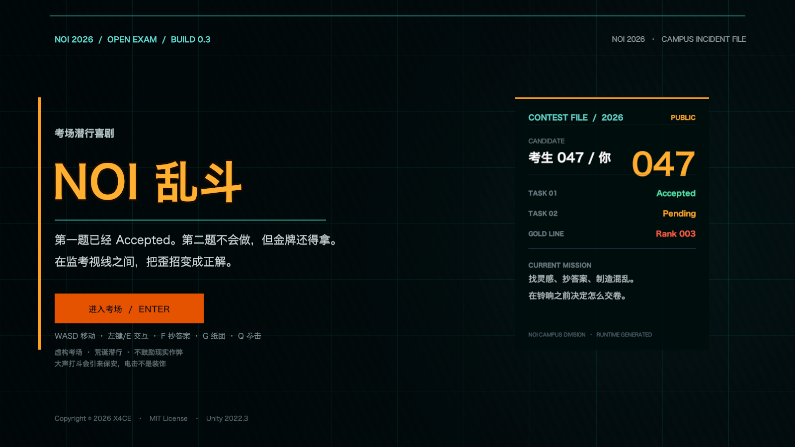
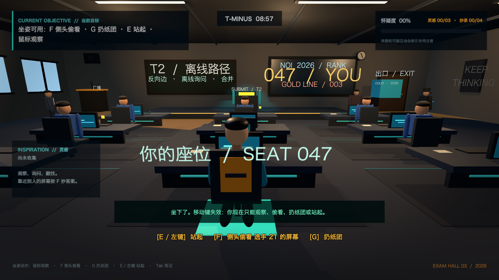

# NOI 乱斗

> 第一题已经拿下，第二题毫无思路。金牌就在考场尽头，而今天，你决定把脑洞开得比时间复杂度还大。

《NOI 乱斗》是一款发生在虚构 NOI 考场中的第三人称 3D 潜行喜剧原型。你需要在监考老师的视线之间寻找线索、制造一点可控的混乱，并在时限内拼出第二题的关键思路。

本项目由 **X4CE** 于 **2026 年** 开始开发，以 MIT License 开源。

## 实际画面





## 当前可玩内容

- 第三人称自由移动、奔跑、跳跃、蹲伏和镜头环绕
- 3D 考场场景，包含机位、讲台、白板、奖项展示柜与可探索侧区
- 两名会巡逻、注视、调查噪音的监考老师
- 怀疑度系统：奔跑、靠近监考和可疑行为都会提高怀疑
- 三条可收集线索与目标笔记本
- 偷看并抄录其他选手答案，再拼出一份高风险答卷
- 可投掷纸团制造噪音，也可以直接离场弃赛
- 可以近身拳击考生或监考老师，但会制造极大动静
- 大声打斗会惊动保安，保安会循声赶来并使用电击器
- 广播、咖啡机、空调、灯光、时钟、海报等多类互动物件
- 可对话的邻座选手
- 正解金牌、抄录金牌、被抓、银牌事故、空白卷和弃赛等多种结局
- 程序化视觉、音效和中文 UI，不依赖外部美术资源

## 环境

- Unity **2022.3.62f3c1**
- Built-in Render Pipeline
- 输入使用 Unity 旧版 Input Manager，无需安装额外输入包

使用 Unity Hub 打开项目根目录，运行 `Assets/Scenes/Main.unity`，点击 Play。

如果场景尚未生成，可以在 Unity 中执行：

`NOI Chaos > Rebuild Main Scene`

### Windows

Unity 版本必须为 **2022.3.62f3c1**。建议在 Windows 上构建；如果在 macOS 上交叉编译 Windows 版本，请在 Unity Hub 中为这个编辑器版本安装 **Windows Build Support** 模块。

1. 使用 Unity Hub 打开按 [Windows 安装步骤](#windows-安装步骤) 准备好的项目。
2. 等待脚本编译完成，确认 Console 没有红色报错。
3. 在菜单栏执行 `NOI Chaos > Build Windows App`。
4. 构建结果位于 `Builds/Windows/NOI Chaos.exe`。
5. 发布或运行时要保留整个 `Builds/Windows/` 文件夹，不要只复制 `.exe` 文件。

也可以从 Windows PowerShell 命令行构建：

```powershell
$Unity = "C:\Program Files\Unity\Hub\Editor\2022.3.62f3c1\Editor\Unity.exe"
$Project = "C:\Path\To\NOI Chaos"

& $Unity -batchmode -nographics -quit `
  -projectPath $Project `
  -executeMethod NOIChaos.Editor.ProjectBootstrapper.BuildWindowsApp `
  -logFile "Logs\windows-build.log"
```

如果 `Main.unity` 缺失或需要重新生成场景，先运行一次下方命令，再执行 Windows 构建：

```powershell
& $Unity -batchmode -nographics -quit `
  -projectPath $Project `
  -executeMethod NOIChaos.Editor.ProjectBootstrapper.SetupProject `
  -logFile "Logs\setup.log"
```

#### Windows 安装步骤

1. 安装 [Unity Hub](https://unity.com/download)。
2. 在 Unity Hub 的 **Installs** 页面安装 Unity `2022.3.62f3c1`。
3. 同一安装项中启用 **Windows Build Support**。
4. 克隆仓库：

   ```powershell
   git clone https://github.com/X4CE-Organization/NOI-Chaos.git
   cd NOI-Chaos
   ```

5. 在 Unity Hub 中选择 **Add project from disk**，打开仓库根目录。
6. 打开 `Assets/Scenes/Main.unity` 并点击 Play，或使用上面的构建菜单生成 Windows 可执行版本。

### macOS

在 macOS 上生成可执行版本：

`NOI Chaos > Build macOS App`

构建输出位于 `Builds/macOS/`。该目录已被 Git 忽略，不会进入源码仓库。

也可以使用命令行生成：

```bash
UNITY="/Applications/Unity/Hub/Editor/2022.3.62f3c1/Unity.app/Contents/MacOS/Unity"
"$UNITY" -batchmode -nographics -quit \
  -projectPath "/path/to/NOI Chaos" \
  -executeMethod NOIChaos.Editor.ProjectBootstrapper.SetupProject \
  -logFile "Logs/setup.log"
```

生成 macOS 可执行版本：

```bash
"$UNITY" -batchmode -nographics -quit \
  -projectPath "/path/to/NOI Chaos" \
  -executeMethod NOIChaos.Editor.ProjectBootstrapper.BuildMacApp \
  -logFile "Logs/macos-build.log"
```

`Builds/Windows/` 和 `Builds/macOS/` 都被 Git 忽略；源码仓库只保存工程，不保存平台构建产物。

## 操作

| 操作 | 按键 |
| --- | --- |
| 移动 | `WASD` |
| 观察 | 鼠标 |
| 奔跑 | `Shift` |
| 跳跃 | `Space` |
| 蹲伏 | `C` |
| 交互 | `E` / 鼠标左键 |
| 坐下、站起 | 对 047 号椅子按 `E` / 鼠标左键 |
| 偷看并抄答案 | `F` |
| 扔纸团 | `G` |
| 拳击 | `Q` |
| 任务笔记本 | `Tab` |
| 暂停 | `Esc` |

### 坐姿规则

坐下后不能移动、奔跑、跳跃、蹲伏或出拳。正常坐在 047 号座位时不会因为普通巡场视线被锁定；一旦偷看答案或扔纸团，会短暂暴露并重新进入监考视线判定。你可以用鼠标转头、`F` 侧头偷看附近的答案、`G` 扔纸团、打开笔记本，或按 `E` / 鼠标左键站起。起身后所有动作恢复。

## 设计原则

本作是夸张化的虚构校园喜剧。游戏中的“歪招”最终服务于寻找解题灵感，而不是鼓励现实考试作弊。现实中的 NOI 请遵守竞赛规则，尊重每一位选手。

## 目录

```text
Assets/
  Editor/                 一键场景与项目设置
  Scenes/                 主场景
  Scripts/
    AI/                   监考巡逻与视野
    Core/                 游戏状态、流程、音频
    Player/               第三人称角色与镜头
    UI/                   标题、HUD、笔记本和结局界面
    World/                程序化考场和交互物
```

## 参与开发

欢迎提交 Issue 和 Pull Request。开始前请先阅读 [CONTRIBUTING.md](CONTRIBUTING.md)。

## 版权

Copyright © 2026 X4CE. Licensed under the [MIT License](LICENSE).
